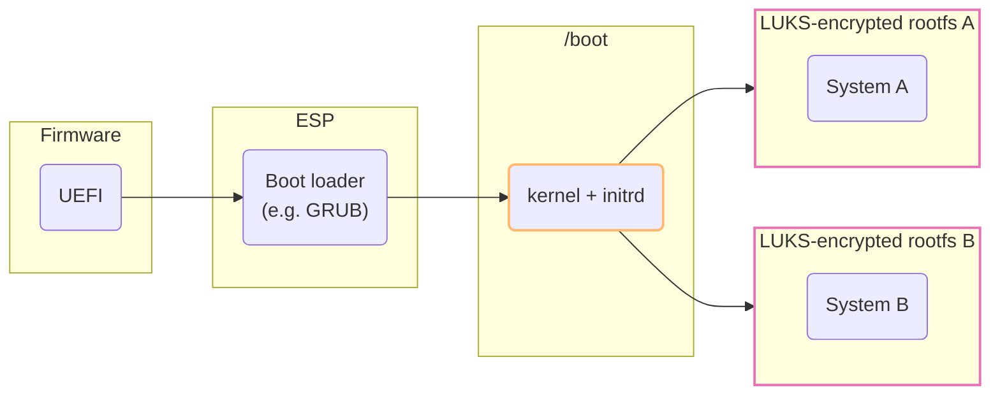
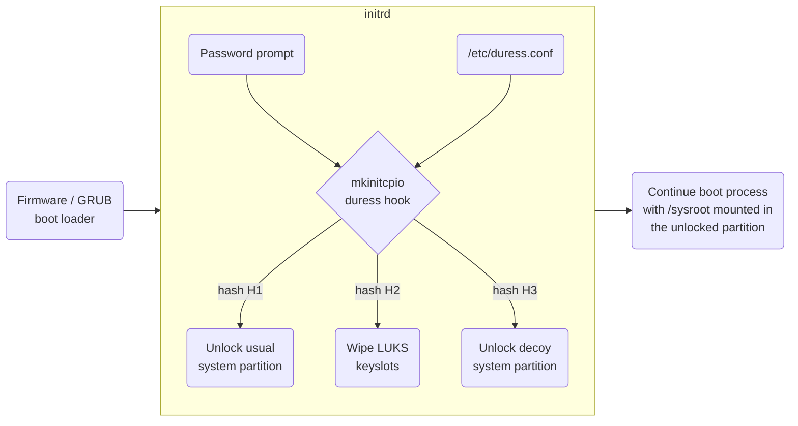

# duress-boot

This project implements a mechanism analogous to [GrapheneOS' duress pin](https://grapheneos.org/features#duress), but for Linux systems booting from [LUKS](https://gitlab.com/cryptsetup/cryptsetup)-encrypted disks.

This allows users to set a **kill-switch password** which, once entered during the boot process, will **erase the cryptographic material** from a specified LUKS partition, making the data stored in that partition irrecoverable (at least in principle, assuming the LUKS headers weren't backed up).

Unlike the original duress pin implementation, this one **can be configured to boot into a decoy OS** (both as an alternative or in addition to erasing the cryptographic keys from another partition), again **depending on what password was typed in**.

> 
> <br>
> In case the GIF above doesn't render, you can see a recorded demonstration [here](https://www.baioc.dev/duress-boot/assets/duress/duress-demo-reboot.gif).

The initial implementation is based on Arch's [mkinitcpio](https://gitlab.archlinux.org/archlinux/mkinitcpio/mkinitcpio), but we plan on adding support for the initramfs generation tools and initrd scripts used in other distros as well.


## Disclaimer

Please note that providing a duress pin to authorities **[might be illegal](https://arstechnica.com/gadgets/2026/07/activist-charged-with-felony-after-giving-border-agent-duress-code-that-wiped-his-phone/) on your jurisdiction**.

Furthermore, the setup required to put this mechanism in place is **not [deniable](https://en.wikipedia.org/wiki/Deniable_encryption)**, its configuration can be **trivially identified with disk forensics**, and even erasing cryptographic keys **will still leave traces** available to a competent adversary.
Please read the [cryptsetup FAQ](https://gitlab.com/cryptsetup/cryptsetup/-/wikis/FrequentlyAskedQuestions) to understand why a kill-switch password or "Nuke-Option" might not be a good idea.

IN NO EVENT SHALL THE AUTHORS BE LIABLE FOR ANY CLAIM, DAMAGES OR OTHER LIABILITY, WHETHER IN AN ACTION OF CONTRACT, TORT OR OTHERWISE, ARISING FROM, OUT OF OR IN CONNECTION WITH THE SOFTWARE OR THE USE OR OTHER DEALINGS IN THE SOFTWARE.


## Usage

First, you need to install our custom mkinitcpio hook:

```shell
$ sudo install -v -m 644 -T \
    duress-boot/mkinitcpio/install.sh \
    /usr/lib/initcpio/install/duress

$ sudo install -v -m 644 -T \
    duress-boot/mkinitcpio/runscript.sh \
    /usr/lib/initcpio/hooks/duress
```

If the scripts are in the right place, you should be able to run `mkinitcpio -H duress` to get an output like this:

```shell
==> Help for hook 'duress':
This hook complements the built-in encrypt hook with a password-driven action
selector. In other words, the user will be prompted for a password at boot, and
depending on what they type in a different action will be executed. This allows
for booting into decoy systems or wiping data when booting under duress.

Users should configure /etc/duress.conf with the duress-mkconfig tool, then
regenerate the initramfs so that the configuration table is actually loaded.
This hook should always be loaded after the encrypt hook in the HOOKS array.

==> This hook has runtime scripts:
  -> pre-mount hook
```

As the documentation explains, the next step is to configure `/etc/duress.conf` using our helper script, `duress-mkconfig`.
Invoke it with the action you wish to associate with a given password (`boot` or `wipe`), provide some options, and the script will prompt you for the password and generate the corresponding configuration line.

```shell
$ sudo install -v -m 755 -T \
    duress-boot/duress-mkconfig.sh \
    /usr/local/bin/duress-mkconfig

$ duress-mkconfig boot 'cryptdevice=...' | sudo tee -a /etc/duress.conf
Password: ****

$ duress-mkconfig wipe 'cryptdevice=...' | sudo tee -a /etc/duress.conf
Password: ****
```

You always need to specify the `cryptdevice=$cryptdev:$cryptname` option - **this is the LUKS partition which will either be unlocked or have its keyslots wiped**.
When booting, you'll also need to set options such as `root` and `rw`; we recommend copying the linux kernel command line from your current bootloader configuration (check in `grub.cfg` if you're using GRUB).

Now, you need to enable the `duress` hook by adding it to the `HOOKS` array in `/etc/mkinitcpio.conf`.
It should be placed before the `encrypt` hook:

```shell
$ grep -e 'HOOKS=' /etc/mkinitcpio.conf

HOOKS=(... duress encrypt ...)
# other hooks omitted for simplicity
```

Finally, just regenerate your initramfs:

```shell
$ mkinitcpio -P

==> Building image from preset: 'default'
==> Using default configuration file: '/etc/mkinitcpio.conf'
  -> -k /boot/vmlinuz-linux -g /boot/initramfs-linux.img
==> Starting build: '7.2.9-arch1-1'
  [...]
  -> Running build hook: [duress]  <-------------------------- new hook
  -> Running build hook: [encrypt]
  [...]
==> Generating module dependencies
==> Creating compressed initrd: '/boot/initramfs-linux.img'
  -> Early uncompressed CPIO image generation successful
==> Initcpio image generation successful
```


## Explanation

### Threat Model

This software was designed against a relatively weak adversary that is not technically-inclined.
This adversary can still put users under duress and compel them to reveal *some* password, but won't be able to identify a decoy system as such, and is unlikely to notice cryptographic keys being silently erased.

### Implementation Details

The current version of this software implements duress logic at the latest possible stage of the boot process: in the initrd, right before unlocking an encrypted rootfs partition.
As a consequence, the Linux kernel is already loaded and **whatever system that finishes booting has to work on top of that same kernel build**.



The duress configuration that's copied into the initrd contains one salted password hash per entry.
At boot time, the hook will go through every entry and re-compute a hash with the password that was typed in, executing the action in that entry if the hashes match.



When executing a `boot` action, the hook overrides some kernel parameters (notably, the `root` partition identifier), and then stops the process as soon as it manages to unlock a partition - that's where the boot process will finish.
In contrast, the `wipe` action executes silently, after which the hook will continue to parse configuration entries - this creates the possibility to, for example, have a duress password that will both erase a sensitive partition and then also boot into a decoy system.

**Please note that duress v1 hashes are not as strong as LUKS key derivation functions** - in order to avoid giving away an easier-to-crack hash of your decryption password, you could let the default `encrypt` hook handle that case, and use the `duress` hook only as an early kill-switch or boot-to-decoy path.


## Development

The definitions in [mkinitcpio/init_functions.mock](mkinitcpio/init_functions.mock) can be used to test the duress hook in a non-initrd environment.
The hook itself will also use `DURESS_CONF_PATH` if defined, so we don't need to constantly change our system-wide `/etc/duress.conf` file.
A reasonable way to test the hook would be something like this:

```shell
# generate some sample configuration entries
$ ./duress-mkconfig.sh boot "cryptdevice=UUID=xxxx:root:allow-discards root=UUID=yyyy rw" >> /tmp/duress.conf
$ ./duress-mkconfig.sh wipe "cryptdevice=UUID=zzzz duress_verbose=y" >> /tmp/duress.conf

# test the duress hook (it'll only echo the commands it would have executed)
$ sh -c '. mkinitcpio/init_functions.mock ; \
         . mkinitcpio/runscript.sh ; \
         set -eu ; \
         export DURESS_CONF_PATH=/tmp/duress.conf ; \
         run_hook'
```

### To-Do List

- Interact with the user via plymouth if available
- Stronger cryptographic hash / PBKDF functions in configuration entries
- Support for the initramfs generators of other distros
- Distro-agnostic implementation within GRUB


## License

Copyright (C) 2026 Gabriel B. Sant'Anna

This program is free software; you can redistribute it and/or modify it under the terms of the GNU General Public License as published by the Free Software Foundation; specifically version 2 of the License.

This program is distributed in the hope that it will be useful, but WITHOUT ANY WARRANTY; without even the implied warranty of MERCHANTABILITY or FITNESS FOR A PARTICULAR PURPOSE.

IN NO EVENT SHALL THE AUTHORS BE LIABLE FOR ANY CLAIM, DAMAGES OR OTHER LIABILITY, WHETHER IN AN ACTION OF CONTRACT, TORT OR OTHERWISE, ARISING FROM, OUT OF OR IN CONNECTION WITH THE SOFTWARE OR THE USE OR OTHER DEALINGS IN THE SOFTWARE.
